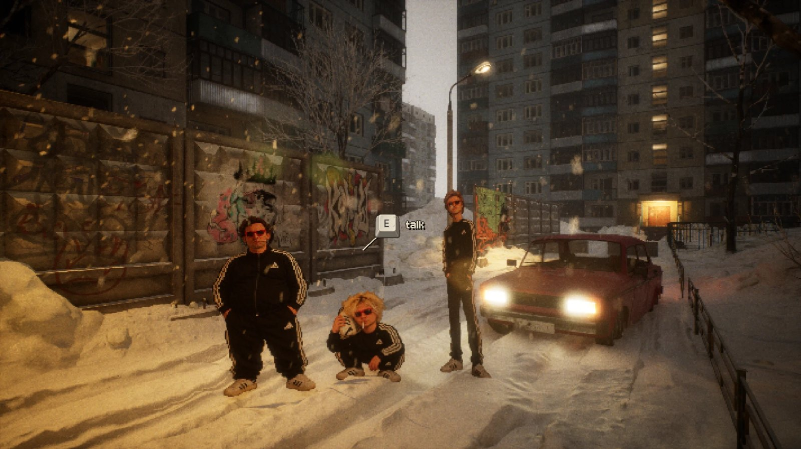
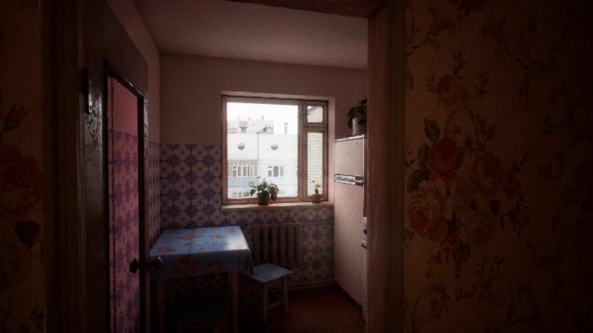
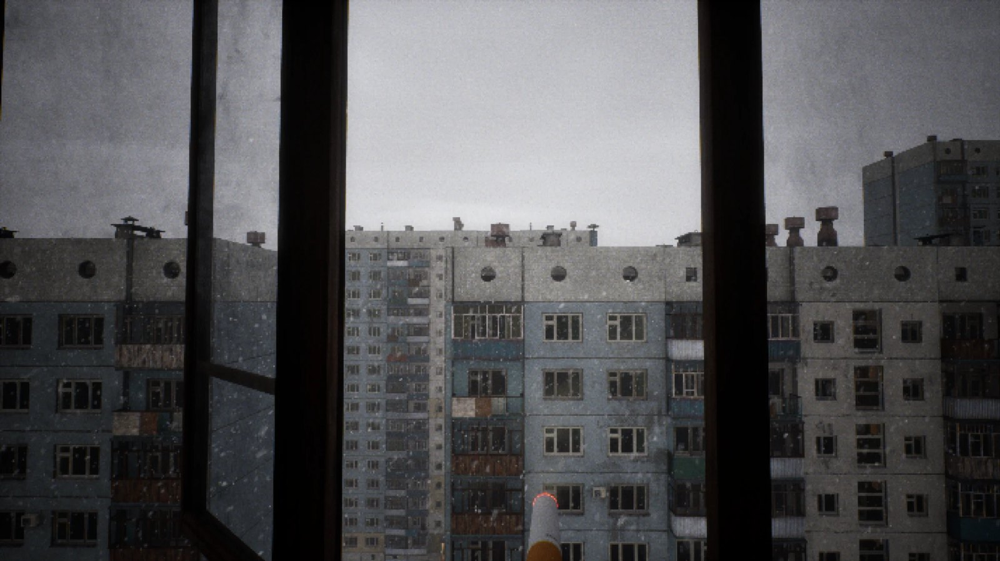
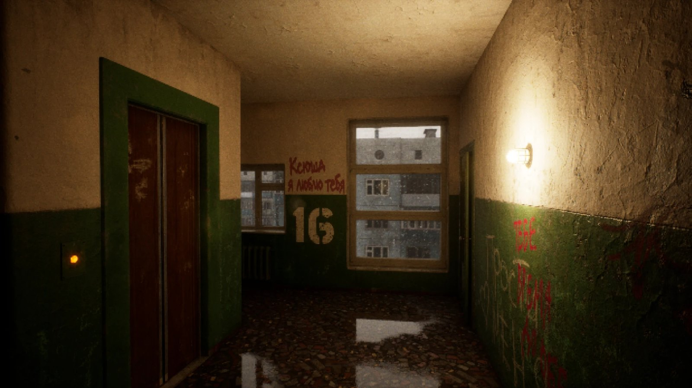
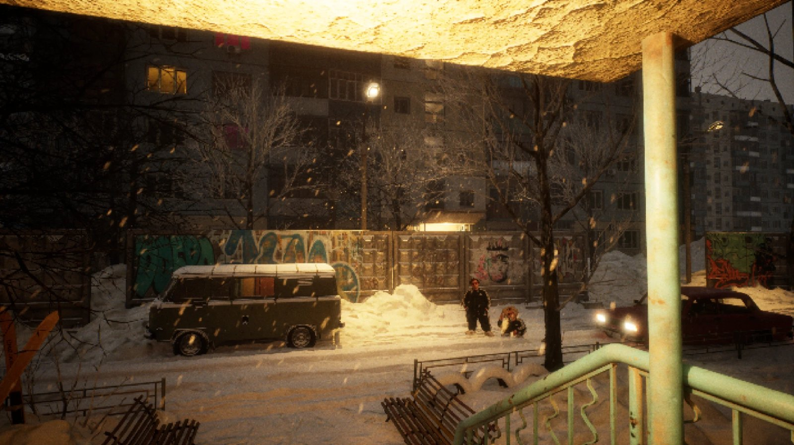
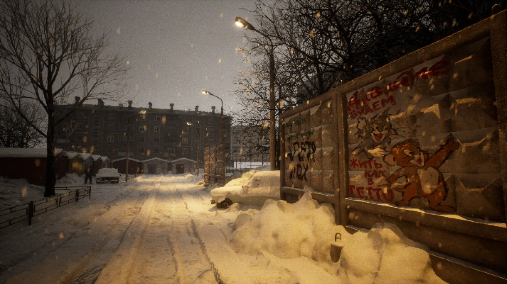
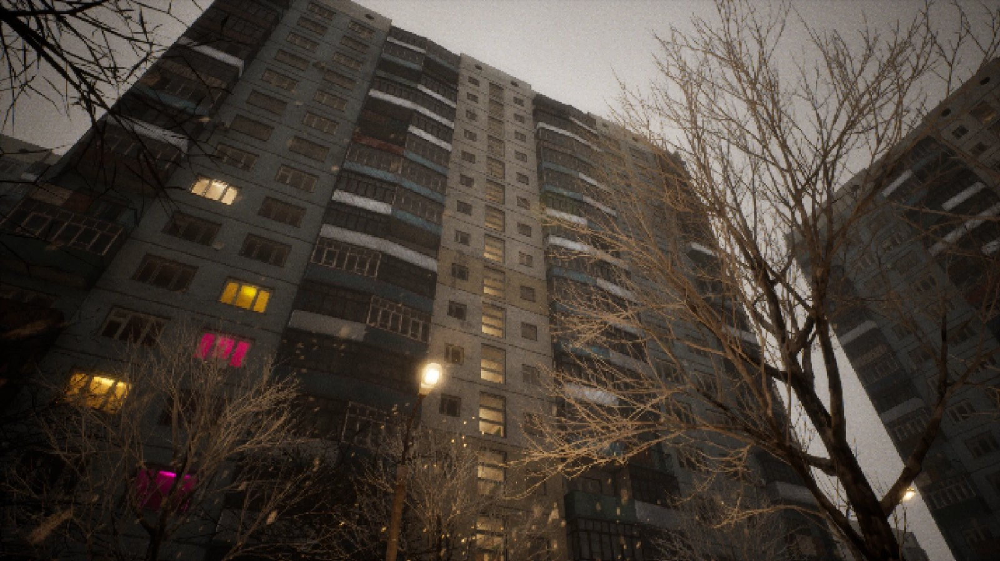
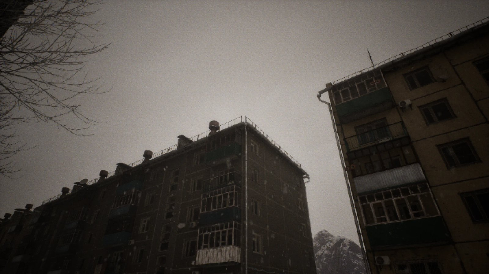

# WIP Capstone Project (UE5 prototype)

 Unzip, open the <code>Windows</code> folder, and run <code>Once_In_Something.exe</code>. The first launch compiles shaders and can sit on black for a minute. <a href="https://github.com/DenyaSolyara/ue5-narrative-prototype/releases/latest">Notes</a>

A young designer finishes university and can't find work. Instead of a job in a nice office downtown, he ends up on the outskirts of the city working at a factory. The game follows his everyday life there: the people he meets, and how he slowly settles into a life he never expected to have.

**Engine:** Unreal Engine 5 · **Built with:** Claude Code and Codex · **Status:** early build. The source is private, and the raw environment art comes from licensed marketplace packs, so only the packaged game is shared.

## Visual style

A post-Soviet neighborhood of concrete apartment blocks in winter: snow, sodium street lights, lit windows, graffiti on the fences. I grew up in places like this, and the goal is the atmosphere more than any single detail. I want the game to carry what it actually feels like to live there, so that people who have never seen a place like it can get a sense of it too.

## Gameplay

An atmospheric first-person walking game. Everything you do runs through a set of interaction scripts: going through doors and between areas, talking to the people you meet, and using objects in the world.

## Screenshots

<table>
  <tr>
    <td></td>
    <td></td>
  </tr>
  <tr>
    <td></td>
    <td></td>
  </tr>
  <tr>
    <td></td>
    <td></td>
  </tr>
  <tr>
    <td colspan="2"></td>
  </tr>
</table>

---

Built with help from AI agents (Claude Code, Codex) that set up and check scenes directly in the Unreal Editor through Python scripts.
