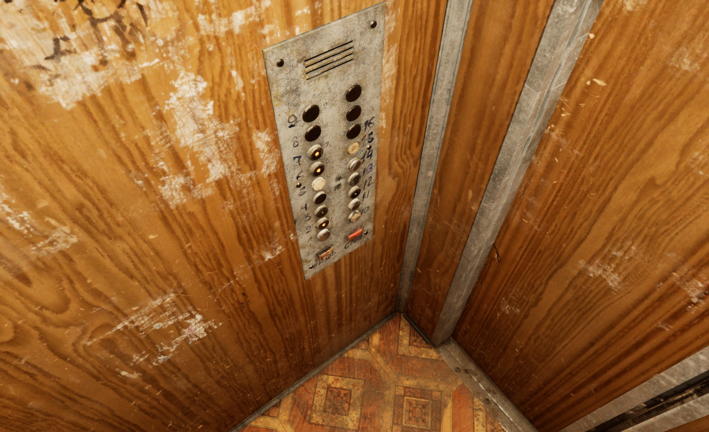

# Untitled First-Person Game (UE5 prototype)

 Unzip, open the <code>Windows</code> folder, and run <code>Once_In_Something.exe</code>. The first launch compiles shaders and can sit on black for a minute. <a href="https://github.com/DenyaSolyara/ue5-narrative-prototype/releases/latest">Notes</a>

An atmospheric first-person walk through a post-Soviet apartment block, its stairwell, and a snowy courtyard, built in Unreal Engine 5. It's in early development, so this repo is a showcase with a playable build. The source is private, and the environment art comes from licensed marketplace packs that can't be redistributed.

**Engine:** Unreal Engine 5, C++ and Python · **Built with:** Claude Code and Codex

---

## Gameplay systems (C++, ~2,700 lines)

- **Interaction framework.** Every interactable implements one shared prompt interface. A custom HUD draws the key hints, anchors them in the world, and dims them when an action isn't available, so the layout never jumps.
- **Dialogue.** Conversations play out visual-novel style with characters standing in the world. Talking to them fades to black, cuts to a camera framing the group with shallow depth of field, and types the lines out at the bottom.
- **Elevator.** A multi-stage state machine runs the whole ride: call, doors opening, boarding, departure, a fade through black, arrival, and exit.
- **Level transitions.** Doors and a balcony connect the spaces, with fades handled by a GameInstance subsystem.
- **First-person walker.** The player leaves snow footprint decals and gets snow footstep audio.
- **Effects.** A custom HLSL world position offset shader makes bead curtains react to the player. There's also wind on curtains and trees, a post-process pixelation pass, Paper2D billboard characters, and flipbook smoke.

## The AI agent workflow

This is the part I'm proudest of. The AI agents don't just write code, they work inside the open editor.

- **Remote execution.** Python runs in the open Unreal Editor over remote execution, so an agent can build and change scenes without closing the editor.
- **120+ editor scripts** with a strict naming scheme:
  - `setup_*` builds a feature in the level.
  - `inspect_*` only reads and reports.
  - `verify_*` checks the result and writes a JSON test report to `Saved/`.
  - `import_*` brings in assets.
- **A fallback for when the editor is closed.** Commandlets run headless, and a file bridge works as a backup.
- **Safety rules for the agents,** kept in a project rules file:
  - Back up a map before every feature.
  - Never trust "the process exited," check the JSON report instead.
  - Never force-close the editor.
  - Ask before any C++ rebuild.

The loop is: describe a feature, the agent writes the C++ and the setup script, the verify script proves it landed, and I playtest.
